# Praktikum 6: JavaScript DOM dan Event Handling

Repository ini dibuat untuk memenuhi tugas **Praktikum 6 - JavaScript DOM dan Event Handling** pada mata kuliah Pemrograman Web (Pertemuan 7).

**Identitas Mahasiswa:**
- **Nama:** Angger Cakra Wicaksono
- **NIM:** 312510054
- **Kelas:** I253A
- **Program Studi:** Teknik Informatika
- **Dosen Pengampu:** Agung Nugroho, S.Kom., M.Kom.
- **Kampus:** Universitas Pelita Bangsa

---

## Tujuan Praktikum

1. Memahami DOM sebagai representasi dokumen HTML yang dapat diakses melalui JavaScript.
2. Menggunakan id, class, dan selector CSS untuk memilih elemen HTML.
3. Mengubah teks, atribut, kelas CSS, dan gaya elemen melalui JavaScript.
4. Menangani event pengguna menggunakan `addEventListener()`.
5. Membuat validasi form dan menampilkan pesan sesuai kondisi input.
6. Mengembangkan halaman interaktif dengan minimal tiga fungsi yang berjalan benar.

---

## Panduan Screenshot Tugas

Simpan semua file tangkapan layar (screenshot) di dalam folder `screenshots/` dengan format nama angka (`1.png` sampai `13.png`) sesuai tabel berikut:

| No File | Halaman / Dokumen | Yang Harus Di-Screenshot / Ditampilkan |
|---|---|---|
| **`1.png`** | `lab6_dom_event/index.html` | **Latihan 1:** Judul halaman berubah menjadi "Belajar JavaScript DOM" dan paragraf berisi "Konten berhasil diubah oleh JavaScript." (sebelum tombol diklik). |
| **`2.png`** | `lab6_dom_event/index.html` | **Latihan 2:** Paragraf berubah menjadi "Tombol diklik pada [jam]" setelah tombol **Klik Saya** ditekan. |
| **`3.png`** | `lab6_dom_event/index.html` | **Latihan 3:** Paragraf dengan kelas `highlight` dan `teks-besar` aktif setelah tombol **Ubah Gaya** diklik. |
| **`4.png`** | `lab6_dom_event/index.html` | **Latihan 4:** Input nama yang sudah diketik beserta jumlah karakternya. |
| **`5.png`** | `lab6_dom_event/index.html` | **Latihan 5 (tidak valid):** Semua input kosong / nama kosong, muncul pesan "Nama wajib diisi." |
| **`6.png`** | `lab6_dom_event/index.html` | **Latihan 5 (tidak valid):** Email salah format (contoh `angger@email`), muncul pesan "Masukkan email yang valid." |
| **`7.png`** | `lab6_dom_event/index.html` | **Latihan 5 (tidak valid):** Usia di bawah 17 (contoh 15), muncul pesan "Usia harus berupa bilangan bulat 17-100." |
| **`8.png`** | `lab6_dom_event/index.html` | **Latihan 5 (valid):** Semua input benar, muncul pesan "Validasi berhasil. Form siap diproses." |
| **`9.png`** | `lab6_dom_event/index.html` | **Latihan 6:** To-do list berisi beberapa tugas, salah satunya sudah ditandai selesai (teks dicoret). |
| **`10.png`** | `lab6_dom_event/workshop/index.html` | **Mini Project (tidak valid):** Form disubmit dengan data salah, kolom bertanda merah dan pesan error tampil. |
| **`11.png`** | `lab6_dom_event/workshop/index.html` | **Mini Project (valid):** Ringkasan pendaftaran terisi dan pesan sukses tampil. |
| **`12.png`** | `lab6_dom_event/eksperimen/index.html` | **Eksperimen Mandiri 1-4:** To-do list dengan tombol hapus, validasi nama minimal 3 karakter, sesi terpilih dari dropdown, dan paragraf yang disembunyikan. |
| **`13.png`** | `lab6_dom_event/eksperimen/tanpa_defer.html` | **Eksperimen Mandiri 5:** Console menampilkan `null` dan error `Cannot set properties of null` karena script di head tanpa `defer`. |

---

## Struktur Folder

```text
Lab6Web/
├── .gitignore
├── README.md
├── index.html
├── screenshots/
│   ├── 1.png
│   ├── ...
│   └── 13.png
└── lab6_dom_event/
    ├── index.html
    ├── style.css
    ├── script.js
    ├── workshop/
    │   ├── index.html
    │   ├── style.css
    │   └── script.js
    └── eksperimen/
        ├── index.html
        ├── eksperimen.css
        ├── eksperimen.js
        ├── tanpa_defer.html
        └── tanpa_defer.js
```

---

## Cara Menjalankan

1. Clone atau download repository ini.
2. Buka file `index.html` di browser (bisa langsung dobel klik, atau lewat Laragon di `http://localhost/Lab6Web/`).
3. Pilih halaman praktikum dari menu navigasi.
4. Tekan **F12** lalu buka tab **Console** untuk melihat output `console.log` dan error.

---

## Langkah-langkah Praktikum

### Persiapan
Dibuat folder `lab6_dom_event` yang berisi `index.html`, `style.css`, dan `script.js`. File CSS dan JavaScript dihubungkan dari `<head>`. Script menggunakan atribut `defer` supaya dijalankan setelah HTML selesai diparsing.

```html
<link rel="stylesheet" href="style.css">
<script src="script.js" defer></script>
```

---

### 1. Mengubah Teks dengan DOM (Latihan 1)
Elemen dipilih menggunakan `getElementById()` lalu isinya diubah dengan `textContent`:

```javascript
const judul = document.getElementById("judul");
const pesan = document.getElementById("pesan");
judul.textContent = "Belajar JavaScript DOM";
pesan.textContent = "Konten berhasil diubah oleh JavaScript.";
```

**Hasil:** Judul awal "Latihan DOM" berubah menjadi "Belajar JavaScript DOM" dan paragraf "Belum ada tindakan." berubah menjadi "Konten berhasil diubah oleh JavaScript."

**Screenshot Hasil (Latihan 1):**  
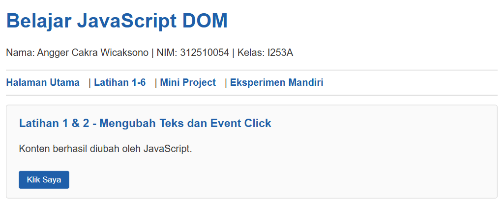

---

### 2. Event Click (Latihan 2)
Tombol diberi event listener `click`. Setiap diklik, paragraf menampilkan jam saat tombol ditekan:

```javascript
const tombol = document.getElementById("tombolAksi");
tombol.addEventListener("click", function () {
    pesan.textContent = "Tombol diklik pada " + new Date().toLocaleTimeString();
});
```

**Hasil:** Saat tombol ditekan beberapa kali, jam pada pesan selalu diperbarui sesuai waktu klik.

**Screenshot Hasil (Latihan 2):**  
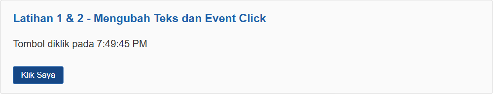

---

### 3. Mengubah Kelas dan Gaya CSS (Latihan 3)
Ditambahkan kelas `.highlight` dan `.teks-besar` pada `style.css`, lalu kelas tersebut di-toggle melalui JavaScript:

```css
.highlight {
    color: #173f75;
    background-color: #e6f1ff;
    border-left: 4px solid #3478c8;
    padding: 12px;
}
.teks-besar { font-size: 1.4rem; }
```

```javascript
tombolGaya.addEventListener("click", function () {
    teksGaya.classList.toggle("highlight");
    teksGaya.classList.toggle("teks-besar");
});
```

Untuk mengamati perbedaannya, ditambahkan juga tombol `classList.add()` dan `classList.remove()`:
- `classList.add()` hanya menambahkan kelas. Diklik berkali-kali hasilnya tetap sama.
- `classList.remove()` hanya menghapus kelas.
- `classList.toggle()` menambahkan kelas jika belum ada dan menghapus jika sudah ada.

**Screenshot Hasil (Latihan 3):**  
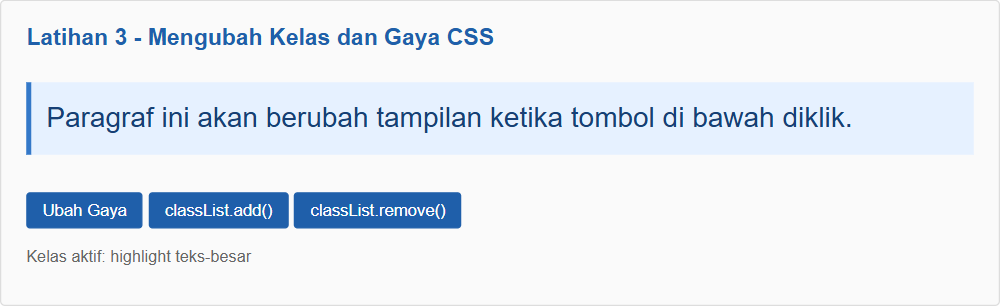

---

### 4. Event Input dan Penghitung Karakter (Latihan 4)
Event `input` dijalankan setiap isi input berubah (mengetik, menghapus, maupun paste):

```javascript
namaInput.addEventListener("input", function () {
    jumlahKarakter.textContent = namaInput.value.length;
});
```

**Hasil:** Jumlah karakter langsung berubah saat mengetik, menghapus, dan menempelkan teks. Karena ada `maxlength="40"`, jumlahnya tidak bisa lebih dari 40.

**Screenshot Hasil (Latihan 4):**  
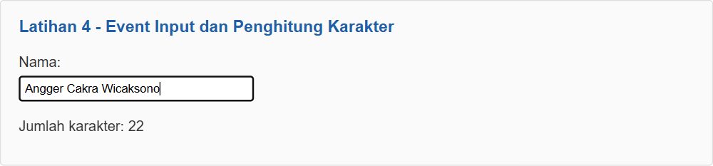

---

### 5. Validasi Form Pendaftaran (Latihan 5)
Form menggunakan atribut `novalidate` sehingga validasi bawaan browser dimatikan dan validasi dilakukan dengan JavaScript. `event.preventDefault()` mencegah halaman dimuat ulang saat form disubmit.

```javascript
form.addEventListener("submit", function (event) {
    event.preventDefault();
    const nama = document.getElementById("nama").value.trim();
    const email = document.getElementById("email").value.trim();
    const usiaInput = document.getElementById("usia").value;
    const usia = Number(usiaInput);
    const polaEmail = /^[^\s@]+@[^\s@]+\.[^\s@]+$/;

    if (nama === "") {
        pesanForm.textContent = "Nama wajib diisi.";
    } else if (!polaEmail.test(email)) {
        pesanForm.textContent = "Masukkan email yang valid.";
    } else if (usiaInput === "" || !Number.isInteger(usia) || usia < 17 || usia > 100) {
        pesanForm.textContent = "Usia harus berupa bilangan bulat 17-100.";
    } else {
        pesanForm.textContent = "Validasi berhasil. Form siap diproses.";
        form.reset();
    }
});
```

Pesan error ditampilkan dengan warna merah dan pesan sukses dengan warna hijau (mengganti `className` pada elemen pesan).

**Hasil Pengujian:**

| No | Kondisi | Input | Pesan yang Muncul |
|---|---|---|---|
| 1 | Semua kosong | - | Nama wajib diisi. |
| 2 | Nama kosong | email & usia diisi | Nama wajib diisi. |
| 3 | Email tidak valid | `angger@email` | Masukkan email yang valid. |
| 4 | Usia di bawah 17 | usia `15` | Usia harus berupa bilangan bulat 17-100. |
| 5 | Semua valid | Angger, angger@gmail.com, 20 | Validasi berhasil. Form siap diproses. |

**Screenshot Hasil (Latihan 5):**  
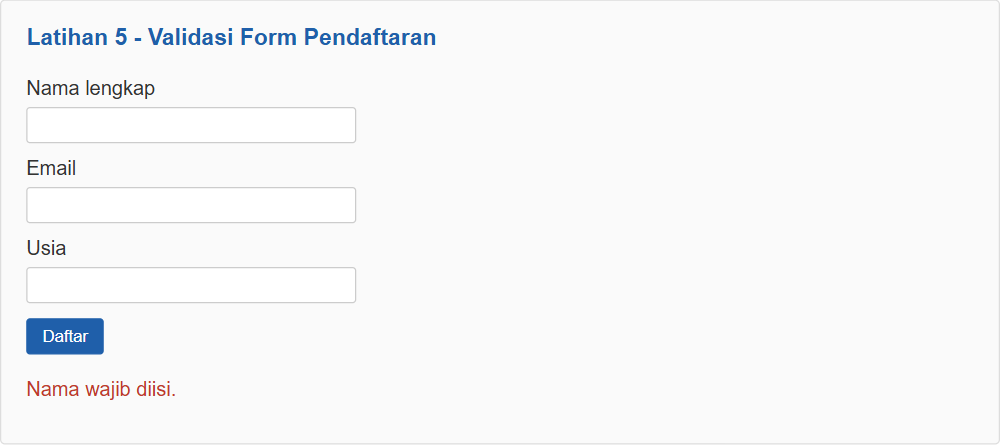
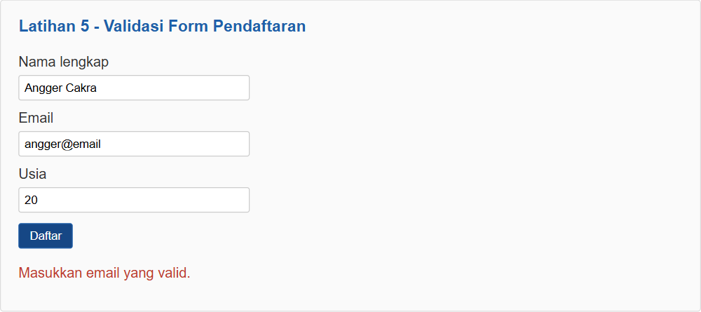
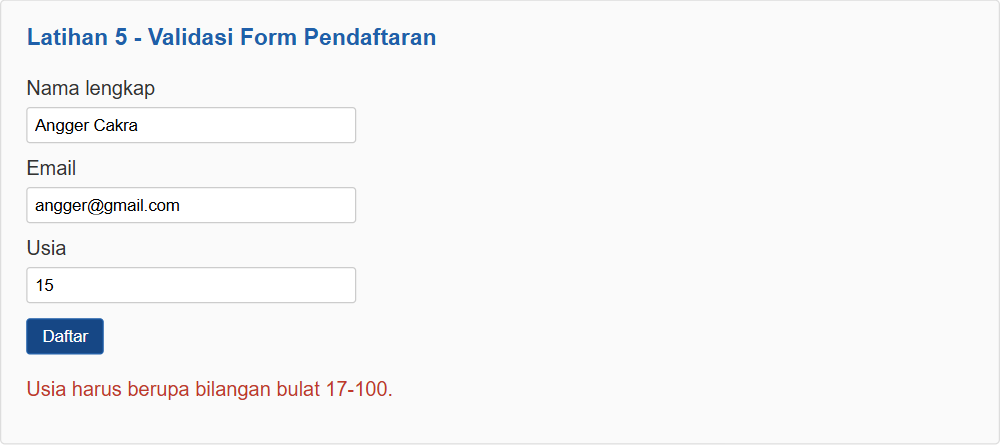
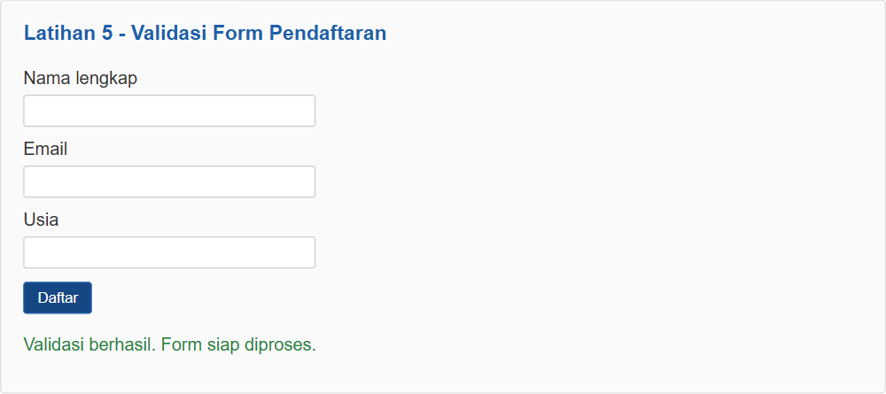

---

### 6. Daftar Tugas Sederhana / To-do List (Latihan 6)
Elemen `li`, `span`, dan `button` dibuat dengan `document.createElement()`, lalu dimasukkan ke dalam `ul` menggunakan `append()` dan `appendChild()`. Tombol "Tandai selesai" melakukan toggle kelas `selesai` sehingga teks tugas dicoret.

```javascript
const item = document.createElement("li");
const label = document.createElement("span");
const selesai = document.createElement("button");
label.textContent = teks + " ";
selesai.type = "button";
selesai.textContent = "Tandai selesai";
selesai.addEventListener("click", function () {
    item.classList.toggle("selesai");
    selesai.textContent = item.classList.contains("selesai")
        ? "Batalkan selesai" : "Tandai selesai";
});
item.append(label, selesai);
daftarTugas.appendChild(item);
```

Teks tugas dimasukkan menggunakan `textContent`, sehingga jika pengguna mengetik `<b>tes</b>` yang tampil tetap teks biasa, bukan HTML.

**Screenshot Hasil (Latihan 6):**  
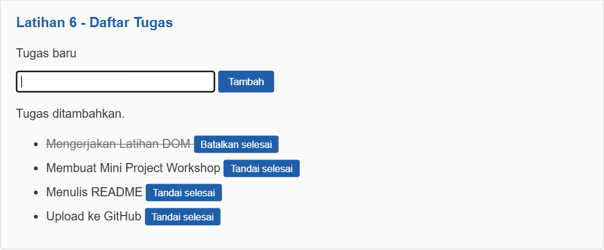

---

## Mini Project: Form Pendaftaran Workshop

File berada di `lab6_dom_event/workshop/` dan dipisah menjadi `index.html`, `style.css`, dan `script.js`. Fitur yang dibuat:

1. **Validasi nama, email, dan pilihan sesi** (event `submit`)
   - Nama wajib diisi dan minimal 3 karakter.
   - Email harus sesuai pola `nama@domain.xxx`.
   - Sesi workshop harus dipilih dari dropdown.
   - Kolom yang salah diberi kelas `salah` (border merah) dan pesan error muncul di bawah kolom.
2. **Ringkasan input secara langsung** (event `input` dan `change`) — tabel ringkasan di samping form langsung terisi saat pengguna mengetik atau memilih sesi.
3. **Penghitung karakter** pada kolom catatan (maksimal 150 karakter).
4. **Pesan kesalahan dan pesan sukses** yang tampil di halaman.
5. **Tombol Hapus Input** (event `click`) untuk mengosongkan form, ringkasan, dan pesan error.

Tampilan menggunakan flexbox dua kolom (form dan ringkasan). Pada layar di bawah 650px (mobile), kolom ringkasan pindah ke bawah form menggunakan media query.

**Skenario Pengujian:**

| No | Input | Hasil |
|---|---|---|
| 1 | Semua kosong | Ketiga kolom bertanda merah, pesan "Pendaftaran gagal..." |
| 2 | Nama `An` | Nama minimal 3 karakter. |
| 3 | Email `angger.com` | Format email tidak valid. |
| 4 | Sesi tidak dipilih | Pilih salah satu sesi workshop. |
| 5 | Semua valid | Pesan sukses "Terima kasih [nama], pendaftaran untuk [sesi] berhasil." |

**Screenshot Hasil (Mini Project):**  
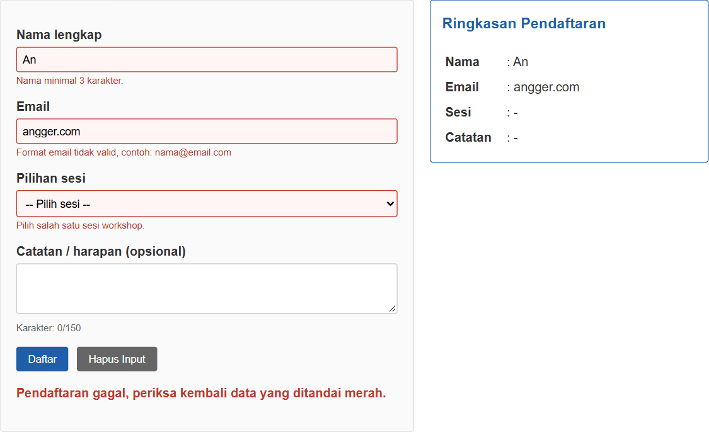
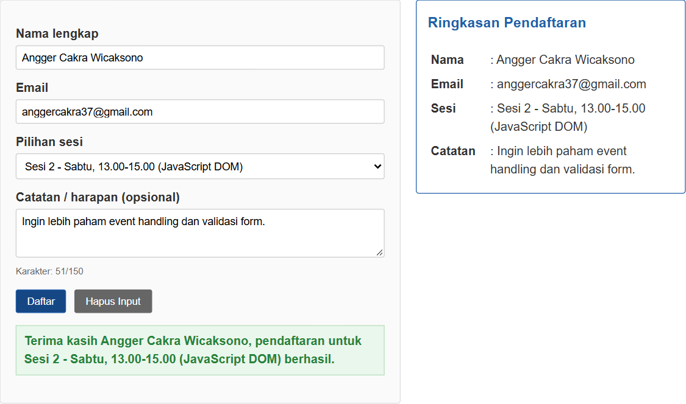

---

## Eksperimen Mandiri

Dikerjakan pada `lab6_dom_event/eksperimen/` sesuai Bagian G modul:

1. **Tombol hapus pada To-do List:** setiap item diberi tombol "Hapus" yang menjalankan `item.remove()`.
2. **Nama minimal 3 karakter:** ditambahkan kondisi `nama.length < 3` pada validasi.
3. **Event change pada dropdown sesi:** sesi yang dipilih langsung ditampilkan di bawah dropdown.
4. **Hide / show paragraf dengan class CSS:** tombol melakukan `classList.toggle("tersembunyi")`, di mana kelas `.tersembunyi` berisi `display: none`. Teks tombol ikut berubah menjadi "Tampilkan Paragraf" / "Sembunyikan Paragraf".
5. **Script tanpa defer di head:** dibuat halaman `tanpa_defer.html` yang memanggil script di `<head>` tanpa `defer`.

**Hasil Eksperimen 5:**
Judul tidak berubah dan pada Console muncul:

```text
Nilai judul: null
Uncaught TypeError: Cannot set properties of null (setting 'textContent')
```

**Penyebab:** browser membaca HTML dari atas ke bawah. Script di `<head>` tanpa `defer` langsung dijalankan sebelum `<body>` dibaca, sehingga elemen `#judul` belum ada dan `getElementById()` menghasilkan `null`. Mengakses `.textContent` dari `null` menyebabkan error dan sisa script berhenti. Solusinya menambahkan atribut `defer`, memindahkan `<script>` ke akhir `<body>`, atau membungkus kode dengan event `DOMContentLoaded`.

**Screenshot Hasil (Eksperimen Mandiri):**  
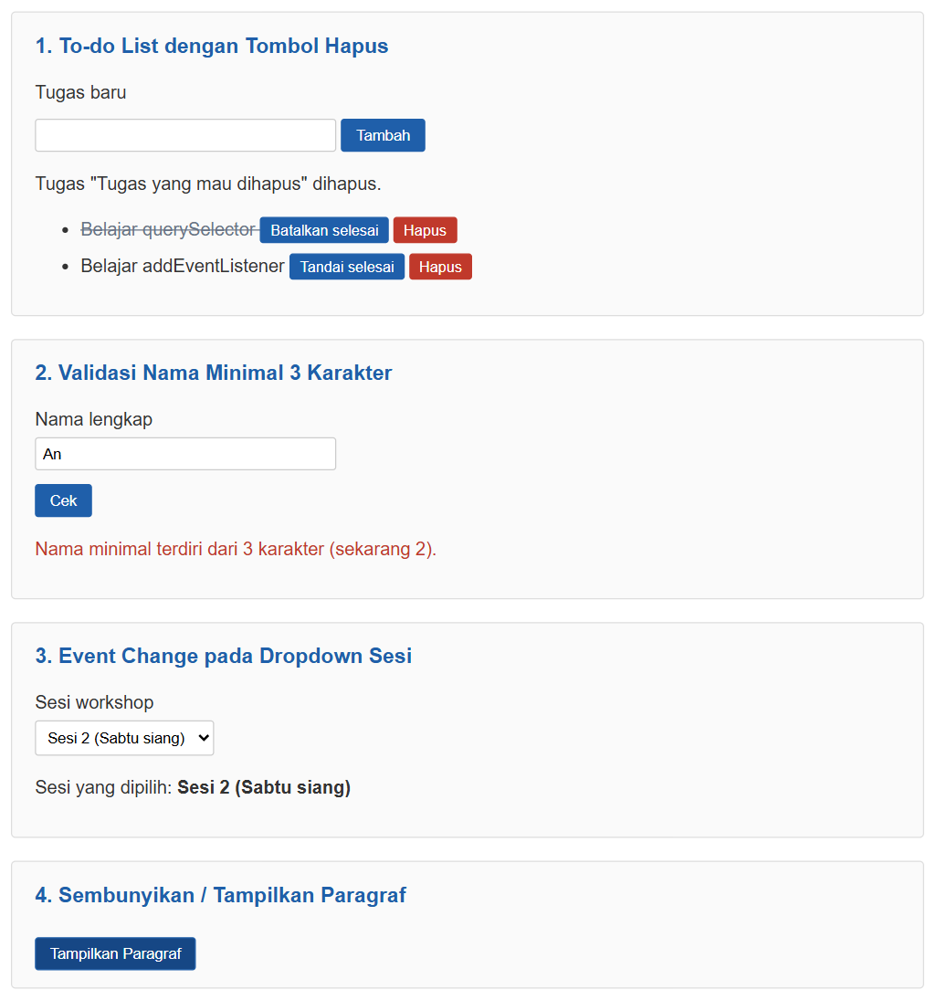
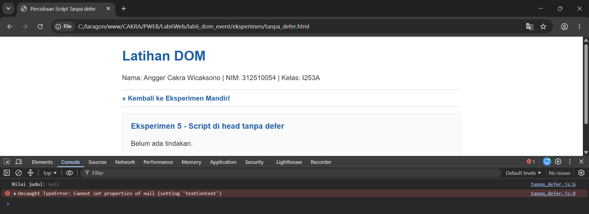

---

## Pertanyaan Evaluasi

#### 1. Apa yang dimaksud dengan DOM dan apa manfaatnya?
DOM (Document Object Model) adalah representasi dokumen HTML dalam bentuk struktur pohon objek yang bisa diakses oleh JavaScript. Setiap tag HTML menjadi sebuah node/objek. Manfaatnya, JavaScript dapat memilih elemen, mengubah isi teks dan atribut, menambah atau menghapus elemen, mengubah kelas CSS, serta merespons aksi pengguna tanpa perlu memuat ulang halaman.

---

#### 2. Apa perbedaan getElementById(), querySelector(), dan querySelectorAll()?
- **getElementById("id"):** memilih satu elemen berdasarkan id (tanpa tanda `#`). Mengembalikan `null` jika tidak ditemukan.
- **querySelector("selector"):** memilih elemen **pertama** yang cocok dengan selector CSS, misalnya `"#tombol"`, `".pesan"`, atau `"form input"`.
- **querySelectorAll("selector"):** memilih **semua** elemen yang cocok dan mengembalikan `NodeList`, sehingga perlu diproses dengan perulangan seperti `forEach`.

---

#### 3. Apa fungsi addEventListener() dan sebutkan tiga contoh event?
`addEventListener()` digunakan untuk menghubungkan sebuah event pada elemen dengan fungsi yang akan dijalankan ketika event tersebut terjadi. Satu elemen bisa memiliki lebih dari satu listener. Contoh event:
- `click` — saat elemen diklik.
- `input` — saat isi input berubah.
- `submit` — saat form dikirim.
- (lainnya: `change`, `keydown`, `mouseover`)

---

#### 4. Mengapa event.preventDefault() digunakan pada event submit form?
Secara bawaan, saat form disubmit browser akan mengirim data dan memuat ulang halaman. `event.preventDefault()` membatalkan perilaku bawaan tersebut supaya halaman tidak reload, sehingga JavaScript sempat memeriksa data dan menampilkan pesan validasi di halaman.

---

#### 5. Apa perbedaan textContent dan innerHTML dari sisi penggunaan dan keamanan?
- **textContent** mengisi elemen dengan teks biasa. Tag HTML akan tampil apa adanya sebagai teks. Lebih aman untuk menampilkan input pengguna.
- **innerHTML** mengisi elemen dengan markup HTML yang akan dirender oleh browser. Berguna untuk menyisipkan struktur HTML, tetapi berbahaya jika diisi input pengguna karena bisa disisipi script berbahaya (serangan XSS).

---

#### 6. Bagaimana classList.toggle() membantu mengubah tampilan elemen?
`classList.toggle("nama-kelas")` menambahkan kelas jika belum ada dan menghapusnya jika sudah ada. Dengan begitu, satu tombol bisa dipakai untuk mengaktifkan dan menonaktifkan tampilan (misalnya highlight, tanda selesai, atau sembunyikan paragraf) tanpa perlu menulis kondisi if-else. Gaya tampilan tetap ditulis di CSS, JavaScript hanya mengganti kelasnya.

---

#### 7. Sebutkan minimal tiga skenario pengujian validasi form.
1. Semua kolom dikosongkan → muncul pesan "Nama wajib diisi."
2. Email diisi tanpa domain, misalnya `angger@email` → muncul pesan "Masukkan email yang valid."
3. Usia diisi 15 (di bawah 17) → muncul pesan "Usia harus berupa bilangan bulat 17-100."
4. Usia diisi 17.5 (bukan bilangan bulat) → pesan usia tidak valid.
5. Semua input benar → muncul pesan "Validasi berhasil. Form siap diproses." dan form dikosongkan.

---